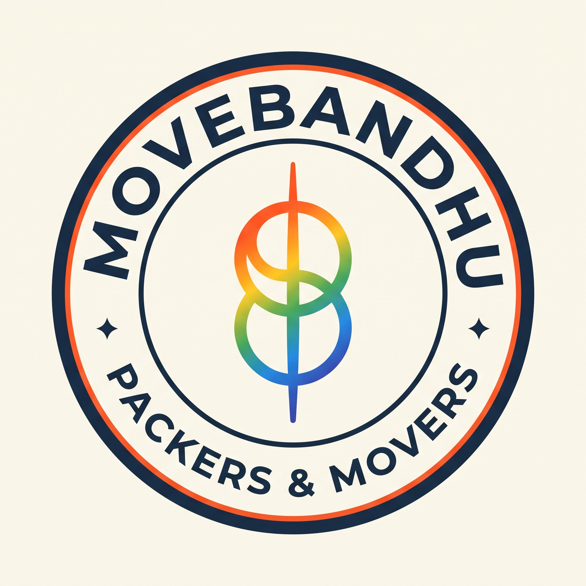

# 🚚 MoveBandhu — Smart Shifting & Logistics Platform

<p align="center">
  
</p>

<p align="center">
  <strong>Reliable Home Shifting & Goods Transportation Across Western Maharashtra</strong><br>
  <em>Kolhapur (MH 09) • Sangli (MH 10) • Satara (MH 11)</em>
</p>

<p align="center">
  <a href="#-features">Features</a> •
  <a href="#-tech-stack">Tech Stack</a> •
  <a href="#-quick-start">Quick Start</a> •
  <a href="#-environment-variables">Environment Variables</a> •
  <a href="#-mongodb-setup">MongoDB Setup</a> •
  <a href="#-project-structure">Project Structure</a> •
  <a href="#-contact--support">Contact</a>
</p>

---

## 🌟 Overview

**MoveBandhu** is a full-stack MERN application tailored for home shifting, furniture transport, and commercial logistics. Built specifically for the Western Maharashtra region, MoveBandhu bridges customers with verified local transport partners (Tata Ace, Bolero Pickup, 14ft Eicher, and 3-Wheelers) with upfront, transparent pricing and zero bargaining hassles.

---

## 🚀 Features

- **⚡ Instant Moving Cost Calculator:** Dynamic quotation based on distance (km), home size (1 RK to 3 BHK+), floor levels, lift availability, and helper requirements.
- **🎥 Immersive Video Intro:** High-definition video intro (`landing.mp4`) with smooth controls, audio toggle, and skip options.
- **🌐 Trilingual Support:** Native language switching between **English**, **मराठी (Marathi)**, and **हिंदी (Hindi)**.
- **📦 Live Booking Tracking:** Track shifting status in real time using unique booking reference codes (e.g., `BK-KOP-8421`).
- **👥 Role-Based Authentication:**
  - **Customer Portal:** Book shifts, track orders, request quotes, and manage personal profile.
  - **Partner / Driver Portal:** Onboarding for local tempo owners (vehicle details, licenses, service areas).
  - **Admin Dashboard:** Control pricing matrices, review leads, assign partners, and monitor active bookings.
- **💬 Direct WhatsApp & Call Integration:** Instant 1-click connection with coordinators and drivers via WhatsApp (`+91 88550 29692`).
- **🎨 Modern Responsive UI:** Crafted with Tailwind CSS, Lucide icons, glassmorphism cards, and customizable theme palettes.

---

## 🛠️ Tech Stack

### Frontend
- **React 19** — Fast, modern component-based UI
- **Vite 6** — Lightning-fast development & production bundler
- **Tailwind CSS** — Utility-first styling with responsive design
- **Lucide React** — Crisp UI iconography
- **Motion (Framer Motion)** — Fluid micro-interactions and transitions

### Backend
- **Node.js** & **Express.js** — Robust RESTful API architecture
- **MongoDB & Mongoose** — Document database with schema validation
- **JWT (JSON Web Tokens)** — Secure user session authentication
- **Bcrypt.js** — Secure password hashing
- **Dual Storage Engine:** Operates seamlessly with MongoDB Atlas and a local JSON store fallback (`data/movebandhu_store.json`).

---

## ⚡ Quick Start

### 1. Clone the Repository
```bash
git clone https://github.com/pranaligadade08-cyber/MoveBandhu.git
cd MoveBandhu
```

### 2. Install Dependencies
```bash
npm install
```

### 3. Configure Environment Variables
Create a `.env` file in the root directory (refer to `.env.example`):
```env
PORT=3000
MONGODB_URI="your_mongodb_atlas_connection_string"
JWT_SECRET="your_jwt_secret_key"
CLIENT_URL="http://localhost:3000"
BUSINESS_PHONE_NUMBER="+918855029692"
BUSINESS_WHATSAPP_NUMBER="+918855029692"
```

### 4. Run the Development Server
```bash
npm run dev
```
Open your browser and navigate to: **`http://localhost:3000`**

### 5. Production Build
```bash
npm run build
npm start
```

---

## 🗄️ MongoDB Setup & Synchronization

MoveBandhu includes an automated sync script to populate your MongoDB Atlas cluster with default services, pricing rules, reviews, and test accounts.

To push all local data into MongoDB Atlas collections:
```bash
node server/scripts/syncToMongo.js
```

### MongoDB Collections:
- **`users`** — Customer, Partner, and Admin credentials
- **`bookings`** — Customer bookings, addresses, inventory, and status history
- **`inquiries`** — Quick estimate and callback requests
- **`partnerprofiles`** — Transporter profiles, vehicle types, and registrations
- **`pricingrules`** — Base charges, per-km rates, helper rates, and vehicle multipliers
- **`services`** — Service listings and descriptions
- **`reviews`** — Customer feedback and ratings

---

## 📁 Project Structure

```text
MoveBandhu/
├── data/
│   └── movebandhu_store.json     # Persistent local JSON data fallback
├── public/
│   ├── landing.mp4               # Landing intro video
│   └── logo.png                  # MoveBandhu brand logos
├── server/
│   ├── config/
│   │   └── db.js                 # MongoDB connection & DataStore logic
│   ├── middleware/
│   │   └── auth.js               # JWT authentication middleware
│   ├── models/                   # Mongoose schemas (User, Booking, etc.)
│   ├── routes/                   # Express API routes
│   └── scripts/
│       └── syncToMongo.js        # MongoDB database sync utility
├── src/
│   ├── components/               # React UI components (Hero, Navbar, Calculator)
│   ├── context/                  # Auth, Language & Theme React Contexts
│   ├── pages/                    # Home, Customer, Partner & Admin dashboards
│   ├── services/                 # Frontend API client
│   └── translations/             # English, Marathi & Hindi localization dictionaries
├── .env.example                  # Environment variable template
├── .gitignore                    # Git ignore configuration
├── package.json
├── server.js                     # Main Express server entry point
├── vite.config.js
└── README.md
```

---

## 📞 Contact & Support

- **Helpline / Phone:** [+91 88550 29692](tel:+918855029692)
- **WhatsApp:** [+91 88550 29692](https://wa.me/918855029692)
- **Head Office:** Kolhapur, Maharashtra — 416001

---

<p align="center">
  Made with ❤️ for Kolhapur, Sangli & Satara | MoveBandhu © 2026
</p>
